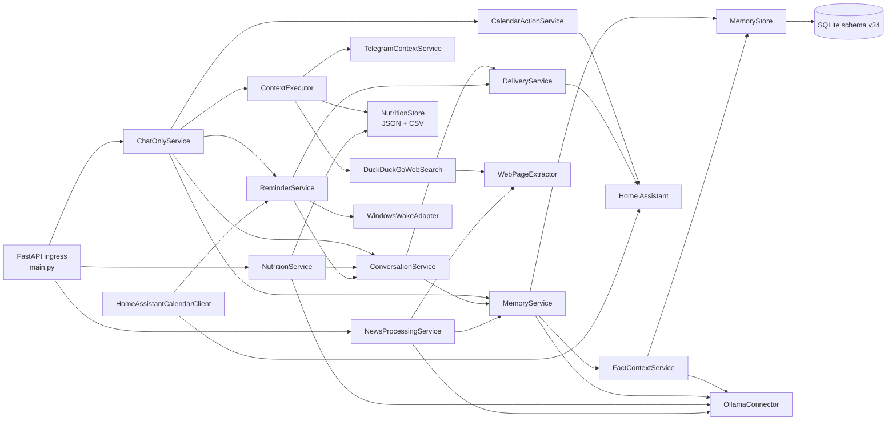
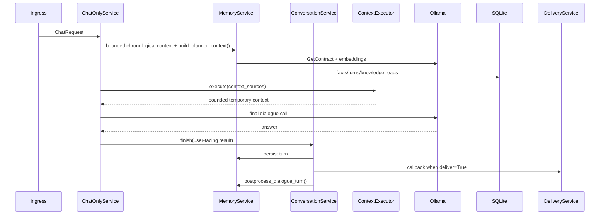

# Архітектура Lumen

## Статус і джерела

Документ звірено з локальним source 2026-10-18; стан deployed executable цим не підтверджено.
Ключові джерела: `src/lumen/main.py`, `src/lumen/services/chat_only.py`,
`src/lumen/services/memory.py`, `src/lumen/services/reminders.py`,
`src/lumen/storage/db.py`.

## Компоненти

Стрілки відповідають constructor wiring та викликам у `main.py`,
`ChatOnlyService` і спільному `ConversationService`.

## Точки входу та запуск

- `python src/lumen/main.py` або Uvicorn запускає `app` з `main.py`;
- `run.bat` запускає `python -m lumen.main` із кореня checkout, використовує
  локальний `.venv`, якщо він є, та host/port із `Settings`;
- `compile.bat` збирає one-file `Lumen.exe`;
- `python -m lumen.reminder_wakeup [db_path]` є entrypoint Windows wake task;
- startup handler запускає `ReminderService.run_due()` і, за наявності
  конфігурації, `HomeAssistantCalendarClient.run_forever()`.

HTTP endpoints визначені тільки у `src/lumen/main.py`.

`POST /news/process` є окремим synchronous Feedreader API, не звичайним
діалогом і не фоновою обробкою всіх новин.

## Runtime: звичайний chat

`/chat` і `/connector` повертають `202` та виконують flow через
`asyncio.create_task()`. `/api/chat` і `/api/generate` чекають той самий
semantic result inline та не викликають callback.

`_start_background_task()` утримує references до chat/connector, reminder
recovery і calendar tasks, логуючи unexpected failures. Shutdown скасовує та
очікує незавершені задачі; це не durable queue і не гарантія delivery після
зупинки процесу.

Knowledge upload спершу добуває текст і перевіряє весь embedding batch, потім
`MemoryStore.replace_embeddings()` замінює лише відповідний user/type/ref у
одній SQLite transaction. Помилка до commit залишає попередній індекс цілим.
Extraction і atomic DB write виконуються через `asyncio.to_thread()`. Завершення
upload (success/error) записується в shared conversation history як короткий
user-facing результат; ім'я файлу, його вміст і transport details не додаються.

## Runtime: Feedreader news

`NewsProcessingService` приймає Feedreader metadata, через shared
`WebPageExtractor` читає final public HTML URL і Trafilatura main text, а за
невдалого extraction використовує RSS fallback від 160 символів. Перший
structured Ollama call відкидає лише technical/editorial junk і зіставляє
article з exact user `news_context/topic:*` `dislikes`; другий call для `keep`
готує 2–4 українські 5W-речення. Результат `keep|skip|retry` містить stable Todo
key від SHA-256 canonical URL. Це request-driven Feedreader API, а не фонове
опрацювання всіх dialogue turns чи native dialogue path. Його внутрішні
classifiers, article fetches і Todo plumbing не додаються до conversation
context; звичайна відповідь на окреме питання користувача про новини йде через
звичайний chat. Недоступний article разом із недостатнім RSS
 контекстом є terminal `skip` (`insufficient_source_context`), тоді як timeout,
 модельні та transport failures лишаються `retry`. Один in-flight job тимчасово має 300-second deadline;
 конкурентний запит отримує `429` і `Retry-After: 60`.

## Telegram → відповідь

У репозиторії немає Telegram bot ingress. Telegram надходить через generic
`/connector` payload, який формує callback metadata у `_callback_metadata()`.
Telegram food photos і текстові виправлення обробляє `NutritionService`
до звичайного chat. Інший текст передається до `ChatOnlyService`;
audio/video attachment проходить `SpeechToTextService`.

Nutrition використовує structured vision/text analysis через наявний Ollama
adapter, per-user lock та `NutritionStore`: authoritative JSON записується
атомарно перед відновлюваною four-column CSV projection. User-facing nutrition
responses проходять через `ConversationService`; receipts і callback correlation
лишаться технічними metadata, не окремими utterances. Nutrition summary у
звичайному chat читає authoritative JSON через `ContextExecutor`.
Receipts забезпечують
dedup за user/chat/message. Окрему HA sent-correlation automation видалено
2026-10-18; нові прив’язки ID підтвердження бота не надходять. Nutrition values лишаються в окремому
JSON/CSV store; user-facing response history використовує наявну SQLite
`conversation_turns` без schema migration.
Контракти, settings і локальний HA helper: `NUTRITION.md`. Multi-worker writes
не підтримуються; packaged shared-history deployment виконано 2026-10-18, див. `HANDOVER.md`.

Окремий `TelegramContextService` — це read-only MTProto lookup для контексту,
не ingress і не сховище повідомлень. Канали й групи читаються зі списку
`memory_facts` / `messenger_context`. Прямо вказаний користувач (`@username`
у поточному запиті) дозволяє разове читання особистої переписки без запису
до списку. Ref лише з model query такого дозволу не дає; перед читанням
Telethon entity має бути `User`.

## Home Assistant → дія або відповідь

- callback delivery: `DeliveryService.post_home_assistant_callback()`;
- calendar create: typed `calendar.create` contract →
  `CalendarActionService.execute()` → один
  `/api/services/calendar/create_event`;
- calendar read/projection: `HomeAssistantCalendarClient.snapshot_today()` та
  WebSocket `calendar/event/subscribe` → authoritative REST reread →
  `_project_calendar_events()` → `ReminderService.upsert_calendar_reminder()`;
- `nutrition/summary` у `ContextExecutor` читає authoritative JSON напряму;
- generic `home_assistant/read_state` і contract-requested `knowledge/search`
  у `ContextExecutor` ще не реалізовані;
- smart-home device control відсутній.

## Reminder flow

`MemoryService.get_contract()` виконує лише model-driven нормалізацію.
`ChatOnlyService` передає reminder contract у
`ReminderService.intercept_contract()`. Сервіс сам виконує user- і route-scoped
пошук, validation, SQLite state transitions та side effects. Contract підтримує
`create`, `list`, `update`, `pause`, `resume`, `delete`, `snooze`, `select` і
`confirm_bulk`; selector використовує stable `id`, нормалізований text query або
короткоживучий session token. Нечіткий/множинний збіг створює persisted
`reminder_management_sessions`; bulk delete потребує окремого підтвердження.

`delete` — soft cancel root і його активних children; історичні rows не
видаляються. `pause` і `resume` працюють лише з manual root: recurring resume
обчислює наступний canonical Kyiv slot, а прострочений one-shot треба спершу
перенести. Calendar projections (`source_ref`) list-visible, але read-only для
цього lifecycle.

`run_due()` claim-ить due rows, викликає `DeliveryService.deliver_reminder()`
і очікує exact `reminder_id` + `delivery_id`. Після configurable grace
(default 30 хв) one-shot стає `missed`, а recurring root переходить до наступного
canonical slot. Silence/`no` також завершує occurrence як пропущене: auto-snooze
немає. Тільки explicit `snooze` створює один child (default 15 хв), який не може
перетнути наступний recurring slot. Transport retry пише `next_attempt_at`, не
змінюючи root `due_at`, і припиняється по завершенні grace window.
Після успішної доставки текст нагадування додається в chronological history як
assistant-only `reminder_notification` із порожнім питанням. `delivery_id`
забезпечує ідемпотентність; збій запису історії не запускає повторну доставку,
а повторюється з `awaiting_confirmation` під час наступного циклу.

`WindowsWakeAdapter` підтримує одну найближчу Task Scheduler задачу з
`WakeToRun`, `StartWhenAvailable`, `AllowStartIfOnBatteries` та
`DontStopIfGoingOnBatteries`. Повне вимкнення ПК він не компенсує: після запуску
recovery застосовує звичайну grace policy.

## Пам’ять і RAG

- `conversation_turns`: turn pair, metadata, topic і question/answer vectors;
- `memory_facts`: profile/preferences, permanent user-only news topic
  `dislikes` та інші normalized facts;
- `memory_embeddings`: knowledge chunks;
- `knowledge_upload_sessions`: upload state;
- `MemoryService.build_planner_context()` паралельно читає semantic,
  topic/lexical dialogue candidates і knowledge candidates;
- `postprocess_dialogue_turn()` добуває facts і заповнює embeddings/metadata.

Для facts `MemoryService` делегує `FactContextService`: `lumen:mandatory`
позначає всі безумовні персональні правила в окремому prompt-блоці; решта
добирається семантично та лексично незалежно від answer mode. Контекстні
fact vectors мають `source_type=memory_fact` і hash/model metadata в чинній
`memory_embeddings`; stale/expired/orphaned vectors не використовуються.
Store інвалідує індекс під час запису/видалення, post-processing відновлює
актуальні vectors. Окрема operator procedure робить початковий backfill.
Повний контракт і бюджети: `docs/CHAT_ONLY_RUNTIME_CONTRACT_UA.md`.

SQLite vector similarity виконується in-process у `MemoryStore`, а не через
окрему vector DB.

Fact-context build використовує ID maps і один lexical score на факт, щоб не
перебирати весь список для кожного index/hit; ranking і budgets збережено.

## LLM

Є один provider adapter: `OllamaConnector`. Він викликає Ollama `/api/chat`,
`/api/embed` або `/api/embeddings`, додає runtime context і використовує
`OLLAMA_CLIENT_KEEP_ALIVE`. `MemoryService` робить contract/fact/topic calls;
`ChatOnlyService._generate_answer()` робить фінальний dialogue call через
внутрішній NDJSON stream. До першого кадру deadline немає; після першого
валідного кадру `OLLAMA_STREAM_IDLE_TIMEOUT_SECONDS` обмежує лише період тиші
між кадрами. Інші Ollama calls залишаються buffered.

Зовнішні `/api/chat` і `/api/generate` не транслюють upstream fragments:
`stream:true` і далі повертає один зібраний terminal NDJSON event. Idle watchdog
не зберігає й не доставляє partial; inline ingress отримує HTTP `504`.

## Конфігурація

`Settings` у `src/lumen/config.py` читає `.env` від `PROJECT_ROOT`. Відносні
DB/log/debug/Telegram-session/nutrition-directory шляхи резолвляться від project root, включно з
PyInstaller mode. Публічний шаблон — `.env.example`.

Calendar read і write вмикаються окремо. Read projection потребує token,
`HOME_ASSISTANT_CALENDAR_ENTITY_IDS` і canonical target chat. Write потребує
token і `HOME_ASSISTANT_CALENDAR_WRITE_ENTITY_ID`.
Reminder lifecycle settings: `REMINDER_GRACE_MINUTES` (default `30`),
`REMINDER_SNOOZE_MINUTES` (default `15`) і
`REMINDER_MANAGEMENT_SESSION_TTL_MINUTES` (default `10`).
Conversation context uses `DIALOGUE_MEMORY_WINDOW_HOURS` (default `3`),
`CONVERSATION_RECENT_TURN_LIMIT` (default `8`) and
`CONVERSATION_CONTEXT_CHAR_LIMIT` (default `6000`).

## Зовнішні залежності

- Ollama HTTP;
- Home Assistant REST, WebSocket і webhook callback;
- Telegram MTProto/Telethon;
- DuckDuckGo HTML search, shared public-page extraction і Trafilatura;
- `ffmpeg` і `faster-whisper`;
- Windows Task Scheduler.

## Підтверджені обмеження

- `ContextExecutor._execute_home_assistant()` і `_execute_knowledge()` — TODO;
- startup запускає один recovery pass, а не in-process scheduler loop;
- Windows wake дозволяє запуск на батареї, але не може виконати нагадування,
  коли ПК повністю вимкнений; recovery не доставляє occurrence старше grace;
- calendar projection охоплює тільки поточний Kyiv day;
- DNS перевіряється перед кожним page request/redirect, але transport не pin-ить
  resolved IP, тому DNS rebinding лишається residual risk;
- delivery/reminder/calendar живі перевірки залежать від зовнішньої
  конфігурації й у межах документаційного аудиту не виконувалися.
