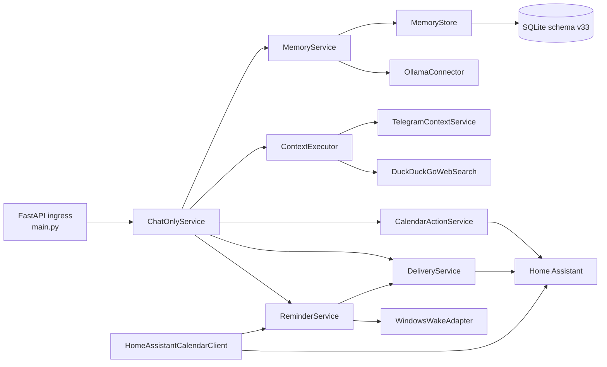
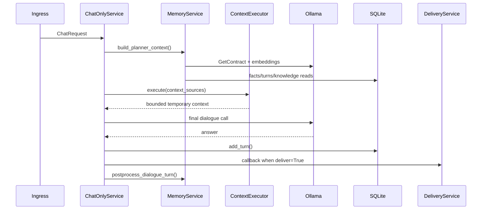

# Архітектура Lumen

## Статус і джерела

Документ описує live wiring гілки `codex/calendar-reminders` на 2026-07-23.
Ключові джерела: `src/lumen/main.py`, `src/lumen/services/chat_only.py`,
`src/lumen/services/memory.py`, `src/lumen/services/reminders.py`,
`src/lumen/storage/db.py`.

## Компоненти

Стрілки відповідають constructor wiring та викликам у `main.py` і
`ChatOnlyService`.

## Точки входу та запуск

- `python src/lumen/main.py` або Uvicorn запускає `app` з `main.py`;
- `run.bat` запускає `uvicorn lumen.main:app --app-dir src`;
- `compile.bat` збирає one-file `Lumen.exe`;
- `python -m lumen.reminder_wakeup [db_path]` є entrypoint Windows wake task;
- startup handler запускає `ReminderService.run_due()` і, за наявності
  конфігурації, `HomeAssistantCalendarClient.run_forever()`.

HTTP endpoints визначені тільки у `src/lumen/main.py`.

## Runtime: звичайний chat

`/chat` і `/connector` повертають `202` та виконують flow через
`asyncio.create_task()`. `/api/chat` і `/api/generate` чекають той самий
semantic result inline та не викликають callback.

## Telegram → відповідь

У репозиторії немає Telegram bot ingress. Telegram надходить через generic
`/connector` payload, який формує callback metadata у `_callback_metadata()`.
Text event передається до `ChatOnlyService`; attachment спершу проходить
`SpeechToTextService`.

Окремий `TelegramContextService` — це read-only MTProto lookup для контексту,
не ingress і не сховище повідомлень. Він читає тільки джерела, allowlisted у
`memory_facts` як `messenger_context`.

## Home Assistant → дія або відповідь

- callback delivery: `DeliveryService.post_home_assistant_callback()`;
- calendar create: typed `calendar.create` contract →
  `CalendarActionService.execute()` → один
  `/api/services/calendar/create_event`;
- calendar read/projection: `HomeAssistantCalendarClient.snapshot_today()` та
  WebSocket `calendar/event/subscribe` → authoritative REST reread →
  `_project_calendar_events()` → `ReminderService.upsert_calendar_reminder()`;
- generic `home_assistant/read_state` у `ContextExecutor` ще не реалізований;
- smart-home device control відсутній.

## Reminder flow

`MemoryService.get_contract()` виконує model-driven нормалізацію.
`ChatOnlyService` передає reminder contract у
`ReminderService.intercept_contract()`. Сервіс валідовує дані та сам володіє
SQLite state machine. `run_due()` claim-ить due rows, викликає
`DeliveryService.deliver_reminder()`, очікує exact
`reminder_id` + `delivery_id`, а silence/`no` створює one-shot child.
`WindowsWakeAdapter` підтримує одну найближчу Task Scheduler задачу.

## Пам’ять і RAG

- `conversation_turns`: turn pair, metadata, topic і question/answer vectors;
- `memory_facts`: profile/preferences та інші normalized facts;
- `memory_embeddings`: knowledge chunks;
- `knowledge_upload_sessions`: upload state;
- `MemoryService.build_planner_context()` паралельно читає semantic,
  topic/lexical dialogue candidates і knowledge candidates;
- `postprocess_dialogue_turn()` добуває facts і заповнює embeddings/metadata.

SQLite vector similarity виконується in-process у `MemoryStore`, а не через
окрему vector DB.

## LLM

Є один provider adapter: `OllamaConnector`. Він викликає Ollama `/api/chat`,
`/api/embed` або `/api/embeddings`, додає runtime context і використовує
`OLLAMA_CLIENT_KEEP_ALIVE`. `MemoryService` робить contract/fact/topic calls;
`ChatOnlyService._generate_answer()` робить фінальний dialogue call.

## Конфігурація

`Settings` у `src/lumen/config.py` читає `.env` від `PROJECT_ROOT`. Відносні
DB/log/debug/Telegram-session шляхи резолвляться від project root, включно з
PyInstaller mode. Публічний шаблон — `.env.example`.

Calendar read і write вмикаються окремо. Read projection потребує token,
`HOME_ASSISTANT_CALENDAR_ENTITY_IDS` і canonical target chat. Write потребує
token і `HOME_ASSISTANT_CALENDAR_WRITE_ENTITY_ID`.

## Зовнішні залежності

- Ollama HTTP;
- Home Assistant REST, WebSocket і webhook callback;
- Telegram MTProto/Telethon;
- DuckDuckGo HTML search та відкриття максимум двох сторінок;
- `ffmpeg` і `faster-whisper`;
- Windows Task Scheduler.

## Підтверджені обмеження

- `ContextExecutor._execute_home_assistant()` і `_execute_knowledge()` — TODO;
- startup запускає один recovery pass, а не in-process scheduler loop;
- calendar projection охоплює тільки поточний Kyiv day;
- delivery/reminder/calendar живі перевірки залежать від зовнішньої
  конфігурації й у межах документаційного аудиту не виконувалися.
